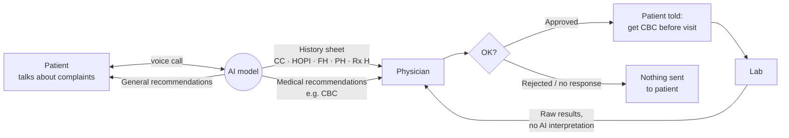

# PRD: PATH, pre-visit AI history taking with physician-gated recommendations

**Status:** Draft v0.6 (P-005: hospital overview, individual doctor accounts, doctor choice, referrals) · **Date:** 2026-10-09 · **Owner:** TBD
**Product name:** **PATH** (Pre-visit Assessment & Triage Helper), adopted in P-006. Despite "Triage" in the expansion, PATH does not triage or assess: it takes the history, and every clinical decision stays with the physician (§3 non-goals).

---

## 1. Summary

Once a patient has an appointment booked (e.g. tomorrow), a **voice AI agent** calls them and takes a full clinical history the way a doctor would. The agent then produces three outputs:

| # | Output | Goes to | Needs physician approval? |
|---|--------|---------|---------------------------|
| 1 | **Structured history sheet** (CC, HOPI, PH, FH, Personal H, Rx H) | Physician, before the visit | No (it is information, not action) |
| 2 | **General recommendations**: self-care and monitoring, e.g. "log your temperature every 2 hours, stay hydrated" | Patient, directly | No, but limited to a clinician-approved library |
| 3 | **Medical recommendations**: suggested investigations, e.g. "fever × 3 days → CBC" | **Physician only** | **Yes.** Nothing reaches the patient until the physician says OK |

If the physician approves, the patient is told to get the test done before the visit. **The results go straight to the physician; the AI does not interpret them or make recommendations from them.**

**Outcome:** the doctor walks into the consult with a complete, well-formatted history and the relevant test results already in hand.

Fever is only the worked example. The system is **specialty-agnostic**: any complaint, any specialty, driven by clinician-authored complaint modules (§8.9).

---

## 2. Problem

- History taking eats a large share of a short consult, and the quality depends on how rushed the visit is.
- Investigations are ordered *at* the visit, so the patient either waits hours for results or comes back another day. Diagnosis gets delayed by one cycle.
- Between booking and the visit, the patient gets no guidance: they don't know what to monitor, and the doctor gets no data on what happened overnight.

## 3. Goals and non-goals

### Goals
1. Every booked patient arrives with a complete history sheet the physician has already seen.
2. Relevant first-line investigations are done **before** the visit, **only** when the physician approved them.
3. Patients get safe, general self-care and monitoring guidance in the meantime.
4. Works for any complaint and specialty by adding content, not code.

### Non-goals (explicitly out of scope)
- **AI interpretation of test results**, or any recommendation based on results. Results go to the physician as-is; the doctor hasn't seen the patient yet and decides what matters.
- Diagnosing, or telling the patient what condition they might have.
- Prescribing or dosing medication (including OTC) to the patient. *(See open question Q6.)*
- Ordering any test without explicit physician sign-off. There is **no auto-approve**, ever.
- Replacing emergency care. Red-flag symptoms get escalated, not handled (§9).
- ~~Appointment booking.~~ *Reversed in P-004:* patients can now book their own appointments in the portal (§8.10). Calendar/availability management is still out of scope.
- **An open-ended AI chat assistant for patients.** In the patient portal the AI only conducts the pre-visit intake call; everything else in the portal is plain pages (P-002).

---

## 4. Users

| User | What they need |
|------|----------------|
| **Patient** | A **patient portal** to sign in to, an easy conversation in their own language, clear instructions on what to do before the visit, and to know when to go to the ER instead |
| **Physician** | Their **own sign-in** and a list of only their own patients (plus referrals), with quick notes; a scannable history sheet, a one-click approve/reject on suggested tests, and the results attached before the visit |
| **Clinic / hospital staff** | A **hospital overview** of all patients and their assigned doctors (no clinical details), emergency alerts for every patient, and lab coordination |
| **Clinical lead / admin** | To author and approve complaint modules, red-flag rules and recommendation libraries, plus the audit trail |

---

## 5. End-to-end flow

This follows the whiteboard: patient ↔ AI; AI → physician (history); AI → patient (general recs); AI → physician (medical recs) → **OK** → patient.

### Timeline (appointment at T)

| When | Step |
|------|------|
| Booking confirmed (ideally T−24h or earlier) | Intake call is triggered; the patient is called or gets a link to start one |
| During the call | History taken; red-flag screening runs throughout |
| End of call | Agent reads a short summary back to the patient to confirm it, then gives the **general recommendations** |
| Within minutes | **History sheet** and **suggested investigations** appear in the physician's queue |
| Physician reviews (target: same day) | Approve / modify / reject each suggested test |
| On approval | Patient is notified: which test, where, prep (e.g. fasting), and the deadline for results to be ready |
| Before visit | Patient does the test; results attach to the physician's sheet |
| Between call and visit | Patient logs monitoring data (e.g. temperature), which also appears on the sheet |
| Visit at T | Doctor has history + logs + results in one view |

Edge cases:
- **Visit in 2 days:** same flow; the test can happen the day in between. The notification states the latest time to test so results are back before T.
- **Physician never responds:** no test is ordered and the patient is not told about any medical recommendation. The general recommendations still stand, and the patient attends as normal.
- **Test done at the hospital on the visit day:** the patient gets the test first thing, before seeing the doctor. The flow is the same and the results attach to the sheet.

---

## 6. Worked example: fever

**Call (abridged):** 34-year-old woman, fever for 3 days, cough for 2 days, body ache since yesterday. Fever up to 102°F, worse at night, with chills. Took paracetamol twice yesterday, which helped briefly. No travel. A colleague had a similar illness. No chronic illness. Father has type 2 diabetes. Non-smoker. Not pregnant.

**Output 1 → physician (history sheet, excerpt):**
> **Chief complaints (chronological):**
> 1. Fever × 3 days
> 2. Cough × 2 days
> 3. Body ache × 1 day
>
> **HOPI:** Fever, insidious onset 3 days ago, intermittent, max 102°F, nocturnal spikes with chills and no rigors; relieved temporarily by paracetamol. Dry cough from day 2... *(each line links to the transcript timestamp)*
>
> **Red-flag screen:** negative (no breathlessness, neck stiffness, rash, confusion, bleeding)

**Output 2 → patient (general recommendations):**
- Check and log your temperature every 2 hours while awake (reply to the SMS or tap in the app)
- Drink plenty of fluids and rest
- **Go to the emergency department now if** you have difficulty breathing, confusion, a stiff neck, a rash that doesn't fade under pressure, or you can't keep fluids down

**Output 3 → physician only (medical recommendation):**
> Suggested: **CBC**. Rationale: fever > 72h with myalgia (complaint module *Fever, adult v1.2*).
> [Approve] [Modify] [Reject]

**Physician approves** → patient gets: *"Dr. X has asked you to get a blood test (CBC) before your appointment. No fasting needed. Visit [lab] any time before 9am tomorrow."*

**Visit:** doctor opens the sheet and sees the history, the overnight temperature log, and the CBC report. The AI makes no comment on the CBC.

---

## 7. History-taking standard

The structure follows standard clinical-methods references (Macleod's *Clinical Examination*, Hutchison's *Clinical Methods*, Bates' *Guide to Physical Examination*). The interview style follows the Calgary–Cambridge consultation model: open questions first, then focused ones.

| Section | Abbrev. | Content |
|---------|---------|---------|
| Patient particulars | — | Name, age, sex, occupation, residence, informant (self / parent / caregiver), reliability |
| Chief complaints | **CC** | Each complaint with its duration, **in chronological order of onset**, in the patient's own words |
| History of presenting illness | **HOPI** | Detailed account of each complaint: onset, duration, progression, character, severity, aggravating/relieving factors, associated symptoms, relevant negatives. Pain uses SOCRATES (Site, Onset, Character, Radiation, Associations, Time course, Exacerbating/relieving, Severity). Includes "has this happened before?" |
| Past history | **PH** | Previous similar episodes, chronic illnesses (DM, HTN, asthma, TB, etc.), hospitalisations, surgeries, transfusions, trauma |
| Treatment / drug history | **Rx H** | Current medications with dose and frequency, what was taken for this illness and its effect, **allergies (drug, food) and reactions**, immunisations where relevant |
| Family history | **FH** | First-degree relatives (and second-degree where relevant): conditions, age at onset, age and cause of death, consanguinity. A three-generation view per standard pedigree practice (NSGC conventions; US Surgeon General's *My Family Health Portrait*) |
| Personal / social history | **Personal H** | Diet, appetite, sleep, bowel and bladder habits, smoking, alcohol, substance use, occupation and exposures, travel, living conditions, sick contacts |
| Review of systems | **ROS** | Brief screen of each system to catch symptoms the patient didn't volunteer |
| Specialty add-ons | — | Menstrual/obstetric history (OB/GYN, females of reproductive age); birth, developmental and immunisation history (pediatrics); psychiatric history and mental status (psychiatry) |

> Your list mentions both "past history" and "present history." In the sheet, **present history = HOPI**, and **past history = PH**, which is kept separate so the doctor can tell what is new from what is background.

---

## 8. Functional requirements

Priority: **P0** = MVP must have · **P1** = pilot should have · **P2** = later

### 8.1 Trigger and onboarding
- **P0** Intake is triggered from an appointment record (manual entry or CSV in MVP; scheduling-system integration later).
- **P0** Patient is reached by outbound call, or by SMS/WhatsApp link to start the call themselves. The link opens the **patient portal** (§8.10).
- **P0** Identity check (name + DOB) and recorded consent covering AI use, call recording, and sharing with the physician.
- **P1** Caregiver/proxy mode (parent for a child, family member for an elderly patient), with the informant recorded on the sheet.

### 8.2 Voice history-taking agent
- **P0** Follows the §7 structure, with adaptive follow-up questions driven by the active complaint module(s).
- **P0** Handles multiple complaints in one call and orders them chronologically.
- **P0** **Red-flag screening runs continuously.** On any trigger, the agent stops the intake and escalates (§9).
- **P0** Reads a short summary back to the patient ("Let me make sure I got this right...") and corrects anything they dispute.
- **P0** Never diagnoses or speculates about a cause. It says "your doctor will review this."
- **P1** Resumes a dropped call where it left off.
- **P1** Multilingual: the sheet is always in the physician's language; the call is in the patient's.
- **P2** Patient can upload photos or old prescriptions and reports during or after the call.

### 8.3 Output 1: History sheet (to physician)
- **P0** Rendered in the §7 format, one page on screen, scannable in under 2 minutes.
- **P0** **Every statement links to its transcript span.** The physician can click to read or hear the source, so nothing in the sheet is untraceable.
- **P0** Shows the red-flag screen result and anything the patient couldn't answer ("unsure of father's age at diagnosis").
- **P1** Exports as PDF and pushes to the EHR (FHIR `DocumentReference`/`Composition`).

### 8.4 Output 2: General recommendations (to patient)
- **P0** Drawn **only** from a clinician-approved library per complaint module. The LLM picks and phrases items but does not invent advice.
- **P0** Always ends with safety-netting: specific "go to the ER if..." triggers for that complaint.
- **P0** Limited to self-care and monitoring: hydration, rest, diet, and what to observe and log. No drugs, doses or tests.
- **P1** **Monitoring logs:** the patient logs readings (e.g. temperature every 2 hours) by SMS reply, app or voice. Logs appear on the physician's sheet as a table or chart, and a logged value that crosses a red-flag threshold triggers escalation.

### 8.5 Output 3: Medical recommendations (to physician only)
- **P0** Suggested investigations, each with a rationale tied to specific history findings and the complaint-module rule that produced it.
- **P0** **Never visible to the patient** unless approved.
- **P0** Physician actions per item: **Approve / Modify / Reject**, plus **Add** a test not suggested.
- **P0** **No auto-approval and no default approval on timeout.**
- **P1** Physician can attach a note to the patient ("fasting sample please").
- **P2** Approval presets per physician ("always approve CBC for fever > 3 days"). These still require the physician to opt in explicitly.

### 8.6 Approval → patient notification
- **P0** On approval, the patient receives the test name(s), where to go, prep instructions, and the latest time to test so results are ready before the visit.
- **P0** Approval is recorded with physician ID and timestamp.
- **P1** Creates the lab order in the lab/LIS system (manual hand-off to staff in MVP).

### 8.7 Results routing
- **P0** Results are attached to the patient's sheet for the physician, by upload (PDF/photo) in MVP and LIS integration later.
- **P0** **The AI does not read, summarise, flag or comment on results.** The lab's own reference ranges and flags are shown exactly as the lab issued them.
- **P1** Physician is notified when results arrive.
- *Patient access to results follows the hospital's existing policy (Q7).*

### 8.8 Physician dashboard
- **P0** List of tomorrow's patients with status: intake done / pending / escalated; tests pending approval / approved / resulted.
- **P0** One view per patient: sheet + suggested tests + logs + results.
- **P1** Mobile-friendly so approvals can happen between patients.

### 8.9 Specialty-agnostic design: complaint modules
Fever is the first module. New complaints and specialties are added as **content authored and signed off by clinicians**, not new code. Each module defines:

| Part | Example (Fever, adult) |
|------|------------------------|
| Trigger phrases | "fever", "temperature", "feeling hot", "chills" |
| Follow-up question set | Duration, pattern, max temp, chills/rigors, associated symptoms, travel, sick contacts |
| Red flags | Neck stiffness, non-blanching rash, confusion, breathlessness, fever in an infant < 3 months |
| General recommendation library | Temperature log every 2h, fluids, rest, safety-netting list |
| Candidate investigations + rules | CBC if fever > 72h; others as defined by clinical lead |
| Specialty add-on sections | e.g. pregnancy status for females of reproductive age |
| Version + approver | v1.2, signed off by Dr. Y on date |

- **P0** Module schema and the Fever module.
- **P1** Five to ten common primary-care complaints (cough, sore throat, abdominal pain, headache, diarrhoea, back pain, UTI symptoms, rash).
- **P2** Specialty packs (OB/GYN, pediatrics, cardiology, psychiatry), each with its clinical owner.

### 8.10 Patient portal (added in P-002)
The patient's home in the product. The AI's only job here is the intake call (§8.2); every other part of the portal is plain pages with no AI.
- **P0** Front page with two doors: **clinicians** (dashboard sign-in) and **patients** (portal sign-in). No patient names or lists are shown on any public page.
- **P0** **Sign-in with a one-time code:** the patient enters their email or phone number and receives a 6-digit code. Since P-004 every contact gets a code, including contacts not yet on file, so the sign-in page never reveals whether someone is a patient. Codes expire after 10 minutes, lock after 5 wrong tries, and requests are rate-limited. No passwords. Session cookie is HttpOnly with sign-out. In demo mode only (synthetic data), the code may be shown on screen because no SMS/email sending exists yet; this is never allowed outside demo mode.
- **P0** The text-message link opens the portal sign-in with the contact pre-filled; the patient still needs the code.
- **P0** Portal home lists the patient's own appointments. Per appointment: start or resume the **pre-visit intake call with the AI (OpenAI)**, self-care advice, tests the doctor has asked for (only after approval and sending, as today), log readings, upload test reports, messages from the clinic.
- **P0** A patient can only ever see their own records.
- **P0** Voice is **tap-to-talk**: every AI reply passes the red-flag check and scope guard **before** the patient sees or hears it. Hands-free live voice (e.g. OpenAI Realtime) is out of scope until it can keep this guarantee.
- **P0** Doctor side: an **"Open patient's view"** button on each patient page, read-only (the doctor cannot act as the patient).
- **P1** Real code delivery by SMS/email (needs a messaging provider; same blocker as phone/SMS).
- **P0** **Shared contacts (P-003, user decision):** signing in with a phone or email shows every appointment booked with that contact (e.g. a household phone for two children), each labelled with the patient's name. This acts as light caregiver access without a separate consent step.
- **P0** **Same patient across bookings (P-003):** bookings with the same name, date of birth and contact belong to one patient. A typo creates a separate patient record; it never merges two people.
- **P0** **Physician access to the patient side (P-003):** only through the read-only "Open patient's view". The patient's own link does not work for staff.
- **P0** **Self-registration (P-004, user decision):** anyone who verifies a phone or email with the code can set up their own details (and those of people they book for). These patients are marked `self_registered`, and the doctor's page shows "identity not checked by clinic".
- **P0** **Self-booking (P-004, user decision):** a signed-in patient can book appointments that are **live immediately**, with no clinic confirmation. Limits: only for people on their own contact, only with a listed doctor, only at a future time within one year, at most 5 upcoming appointments per patient. The doctor sees a "booked by patient" badge. **Known gap:** there is no availability or calendar check, so double-booking is possible.
- **Pilot guards for P-004 (must be met before any real-patient pilot):** (1) bookings come from, or sync with, the clinic's own scheduling system, or need clinic confirmation before the intake runs; (2) any publicly hosted site caps self-registrations and AI-call spend; (3) self-registered identities are checked by the clinic before the visit.
- **P2** Caregiver/proxy access to a patient's portal with explicit consent (ties to §8.1 caregiver mode); revisit the shared-contact rule when this is designed.

### 8.11 Hospital overview, doctor accounts, doctor choice and referrals (added in P-005)
- **P0** **Doctor choice at booking.** When a patient books in the portal, the system **suggests doctors** and the patient picks one.
  - Suggestions are **rule-based, no AI**: each doctor has a specialty and keywords. Ranking: keyword matches on the visit reason, a paediatrics boost for patients under 16, general practice as fallback, fewest upcoming appointments as tiebreak.
  - The "why suggested" text **only quotes the patient's own words** (e.g. "Matches 'cough' in your visit reason") and **never names a condition**, so the suggestion cannot read as a diagnosis. **General practice is always offered.**
  - If the visit reason contains emergency words, the patient sees the **full fixed emergency script** (§9) and must acknowledge it before continuing; the event is audit-logged. No staff alert from a keyword alone. The intake call's red-flag check still runs later.
  - Staff booking (form and CSV) also picks a doctor from the list.
- **P0** **Hospital overview** (`/dashboard`, staff login): every patient with their assigned doctor, appointment time, status and an emergency flag. **No clinical details** and no links into them.
  - **Emergency alerts are visible to hospital staff for every patient**, and staff can acknowledge them there as well as the assigned doctor. A red-flag alert never depends on one doctor being signed in.
- **P0** **Individual doctor sign-in**: email + 6-digit one-time code (same mechanism as patients, role "doctor"; demo mode shows the code). Supersedes the shared physician login for all clinical pages.
- **P0** **Per-patient access.** A doctor sees a patient only if one of the patient's appointments is assigned to them or the patient was **referred** to them; otherwise the page does not exist for them (404). All clinical pages (patient detail, print, patient view, approve/modify/add/notify, result download, alert acknowledgement) require doctor sign-in and this check.
  - **Approvals record the signed-in doctor** (closes the §8.6 audit gap from the shared login).
- **P0** **Doctor's own list**: Doctor A sees all their own patients, with **quick notes** per patient (clinician-only, never shown to the patient, never sent to the AI).
- **P0** **Referrals**: a doctor with access can refer a patient to another doctor, with a note. The receiving doctor **automatically gets access**. Referrals are audit-logged. A patient who is only with one doctor is visible only to that doctor (and to staff on the overview, without clinical details) unless referred.
- **Pilot guards for P-005 (before any real-patient pilot):** (1) **break-glass access** for a covering doctor when the assigned doctor is away, with reason and audit; (2) **demo-mode code display must never run on a public URL**, since anyone could sign in as any doctor; (3) individual staff accounts for the hospital overview instead of a shared staff login.

---

## 9. Safety and clinical governance

- **Red-flag escalation (P0):** when the patient describes an emergency, the agent stops and says clearly: *"This needs urgent attention. Please call [emergency number] or go to the nearest emergency department now."* Clinic staff are alerted and the event is logged. Baseline triggers include chest pain or pressure, difficulty breathing, stroke signs (BE-FAST), loss of consciousness or seizure, severe bleeding, suicidal thoughts or self-harm, fever with stiff neck or non-blanching rash, fever in an infant under 3 months, and bleeding or severe pain in pregnancy. Each module adds its own.
- **Human in the loop for every medical action.** Only physician approval converts a suggestion into an order.
- **Traceability.** Every sheet line is linked to the transcript, and every recommendation to a module rule and version.
- **Content governance.** Modules are versioned, need a named clinician to sign off, and changes are logged.
- **Audit log.** Calls, outputs, approvals (with the signed-in doctor), referrals, notifications and result uploads are all recorded.
- **Scope guard.** The agent refuses diagnosis, medication advice and result interpretation questions, redirecting the patient to their doctor.

## 10. Privacy, security and regulatory

- All data is PHI: encrypted in transit and at rest, role-based access, defined retention, recordings handled per consent.
- **Patient portal accounts (P-002):** one-time-code sign-in, code expiry and lockout, rate limiting, secure session cookies, each patient sees only their own records, and sign-in events go to the audit log.
- Applicable regime depends on market (Q1): **HIPAA** (US), **DPDP Act 2023** (India), **GDPR** (EU/UK).
- **Regulatory position (needs counsel):** physician-facing suggestions with a visible, reviewable rationale are designed to fit the FDA's non-device clinical decision support criteria. Patient-facing output is deliberately limited to general self-care and safety-netting. Both claims need validating for the target market before the pilot.

## 11. Integrations

| System | MVP | Later |
|--------|-----|-------|
| Appointments | Manual entry / CSV; patient self-booking in the portal (P-004) | Scheduling system API / HL7 SIU; self-bookings sync with or come from it (pilot guard) |
| EHR | PDF download | FHIR push |
| Lab | Staff hand-off + PDF upload | LIS order + results (HL7 ORM/ORU or FHIR) |
| Patient messaging | SMS | WhatsApp, app push |
| Patient portal sign-in codes | Shown on screen in demo mode only | SMS / email delivery |
| Voice / telephony | One provider, one language | Multilingual, inbound and outbound |

## 12. Success metrics

| Metric | Pilot target (to be confirmed) |
|--------|-------------------------------|
| Intake completion rate (booked → completed call) | ≥ 60% |
| History sheet accuracy vs physician's own history (clinician-graded) | ≥ 90% of key facts correct; **0 fabricated facts** |
| Red-flag recall on test scenarios | **100%** |
| Physician approval rate of suggested tests | Track it. Too low means noisy suggestions; near 100% means check for rubber-stamping |
| Results available at time of visit (when test approved) | ≥ 70% |
| Consult time spent on history | ↓ measurable vs baseline |
| Physician satisfaction ("would use for all patients") | ≥ 4/5 |
| Patient satisfaction / ease of call | ≥ 4/5 |

## 13. Risks

| Risk | Mitigation |
|------|-----------|
| Agent misses an emergency | Continuous red-flag screen, conservative triggers, 100%-recall release gate, plain safety-netting in every call |
| Hallucinated history | Transcript-linked statements, read-back to the patient, clinician-graded eval set |
| Physicians don't review in time | Mobile approvals, notifications, and a design where silence means "do nothing" so it is safe |
| Rubber-stamp approvals | Show rationale, monitor approval patterns, keep suggestion sets small |
| Patient treats general advice as treatment | Clear wording, no drugs or doses, explicit "your doctor will decide" |
| Scope creep into result interpretation | Written non-goal; no code path from results to the LLM |
| Self-booking without clinic check (P-004): double-bookings, visits the clinic doesn't know about, fake identities, open sign-up running up AI costs | Doctor sees "booked by patient" and "identity not checked by clinic"; booking limits; pilot guards in §8.10 (scheduling-system sync or clinic confirmation, sign-up and spend caps for public hosting, identity check before the visit) |
| Doctor suggestion read as a diagnosis (P-005): routing by symptoms implies a cause ("chest tightness → Cardiology") | Rule-based only, no AI; reason text quotes the patient's words and never names a condition; general practice always offered |
| Emergency alert missed because the assigned doctor is offline (P-005) | Alerts shown and acknowledgeable on the hospital overview for all patients; break-glass access is a pilot guard |
| Demo-mode doctor sign-in exposed publicly (P-005): code shown on screen lets anyone sign in as any doctor | Pilot guard: demo mode never on a public URL (ties to D.2 hosting, PB.3) |
| Shared contact exposes records (P-003): adults sharing a phone/email, or staff entering one placeholder number for many patients, see each other's appointments | Accepted for now by user decision. Before any real-patient use: warn staff on the booking form when a contact is already used by another patient, and revisit with caregiver consent (§8.10 P2) |

## 14. Open questions

1. **Market and regulation:** which country or countries for the pilot?
2. **Buyer:** hospital, clinic chain, or individual practices? Who signs the contract and who owns the liability?
3. **Pilot specialty:** general medicine / primary care first?
4. **Languages** needed at launch?
5. **Call mode:** outbound call from us, or does the patient start it from a link? Both?
6. **OTC medication:** may the general recommendations ever mention paracetamol etc., or never? (Current draft: never.)
7. **Results to patient:** do patients see their own results before the visit, or only the physician?
8. **Approval window:** what is the latest a physician approval is still useful (e.g. visit at 10am, lab opens at 7am)?
9. **Lab:** is it always the hospital's own lab, or external labs too?
10. **Clinical owner:** who signs off on complaint modules and the red-flag list?
